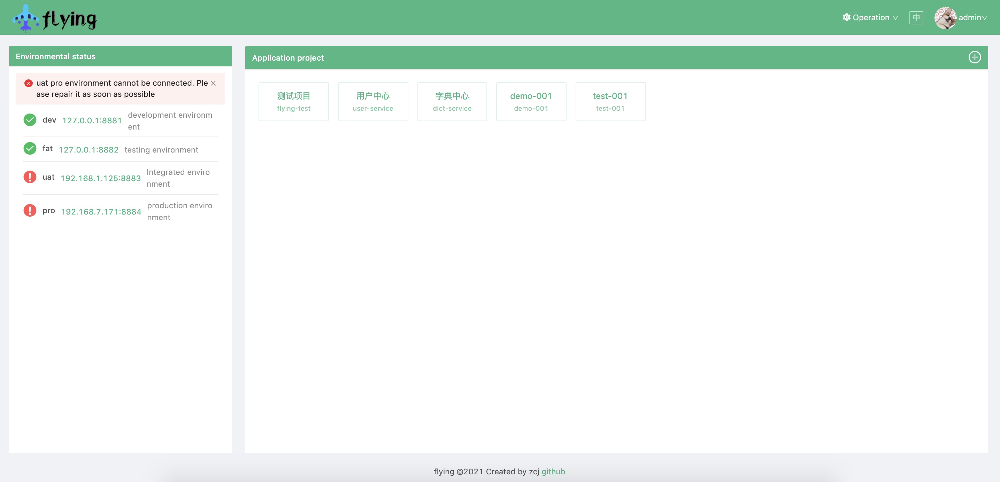

     

[Flying](https://github.com/ZhangChengJi/flying.git) is a microservice multi-environment cloud native configuration center



> English | [Chinese](README_zh.md)

## Overview

Flying is an open-source cloud-native configuration center designed for microservice systems that run across multiple environments, clusters, and deployment stages.

In modern enterprise systems, services are no longer deployed in a single fixed environment. A real-world microservice platform often needs to manage configuration across development, testing, staging, production, private cloud, public cloud, and Kubernetes clusters. Flying provides a unified configuration management layer for these scenarios.

It helps teams centrally manage application configuration, publish changes safely, push updates to clients in real time, and monitor the connection status of configuration servers across different environments.

Flying is especially suitable for:

- Cloud-native microservice platforms
- Multi-environment enterprise applications
- Kubernetes-based deployment systems
- Internal developer platforms
- Configuration management for distributed systems
- Teams that need lightweight, open, self-hosted infrastructure

------

## Why Flying Matters

Configuration management is a foundational part of the microservice ecosystem. Without a reliable configuration center, teams often duplicate configuration files, manually update environment variables, restart services for every change, or maintain different configuration logic in every environment.

Flying solves this by providing an open and self-hosted configuration infrastructure with:

- Unified management for multiple environments and clusters
- Real-time configuration publishing and hot reload
- Secure and efficient gRPC communication with TLS encryption
- A web-based management console
- A Java client for Spring Boot applications
- Docker and Kubernetes deployment support
- A modular architecture that can be extended to more languages and deployment models

Although Flying is a lightweight project, it addresses an important infrastructure problem in the cloud-native and microservice ecosystem: how to manage configuration consistently, safely, and efficiently across distributed systems.

------

## Features

### Multi-environment configuration management

Manage configuration for different environments from a single admin console.

Common environment examples:

- `DEV` — development environment
- `FAT` — functional testing environment
- `UAT` — user acceptance / regression testing environment
- `PRO` — production environment

### Multi-cluster support

Flying is designed for systems where services may run in multiple Kubernetes clusters or isolated environments. The admin console can manage multiple `flying-config` servers deployed in different environments.

### Real-time configuration hot reload

After a configuration is modified and published, the client can receive the latest configuration update without restarting the application.

### gRPC-based communication

Flying uses gRPC for remote communication between components, providing efficient communication for distributed configuration delivery.

### TLS encryption

Remote communication supports TLS encryption, making it suitable for internal enterprise environments where secure service-to-service communication is required.

### Web-based admin console

`flying-admin` provides a management UI for:

- Environment management
- Application management
- Namespace management
- Configuration editing
- Configuration publishing
- Multi-server connection status monitoring

### Java client for Spring Boot

`flying-client` allows Spring Boot applications to load configuration from Flying and receive updates in real time.

### Docker and Kubernetes deployment

Flying provides deployment scripts for Docker Compose and Kubernetes, making it easy to run locally or deploy into cloud-native environments.

------

## Architecture

Flying consists of three main components:

```text
┌──────────────────────┐
│     flying-admin     │
│  Management Console  │
└──────────┬───────────┘
           │
           │ Manage environments,
           │ applications and namespaces
           ▼
┌──────────────────────┐
│    flying-config     │
│ Configuration Server │
└──────────┬───────────┘
           │
           │ gRPC + TLS
           │ Real-time config push
           ▼
┌──────────────────────┐
│    flying-client     │
│ Application Client   │
└──────────────────────┘
```

### flying-admin

The management console used to manage multiple `flying-config` servers.

Main responsibilities:

- Manage environments
- Manage applications
- Manage namespaces
- Publish configuration
- Monitor configuration server connection status

### flying-config

The configuration server.

Main responsibilities:

- Store configuration data
- Serve client configuration requests
- Push configuration update notifications
- Support deployment in multiple environments or clusters

### flying-client

The application-side client.

Main responsibilities:

- Load remote configuration during application startup
- Listen for configuration changes
- Refresh application configuration in real time
- Integrate with Spring Boot applications

Currently, the Java client is implemented. More language clients can be added in the future.

------

## Repository Structure

```text
flying
├── deployments       # Docker Compose and Kubernetes deployment files
├── docs              # Documentation
├── flying-admin      # Admin console backend
├── flying-client     # Java client SDK
├── flying-config     # Configuration server
├── flying-ui         # Web management UI
├── proto             # gRPC protocol definitions
├── README.md
├── README_zh.md
└── LICENSE
```

------

## Quick Start

### 1. Clone the repository

```bash
git clone https://github.com/ZhangChengJi/flying.git
cd flying
```

### 2. Start with Docker Compose

```bash
docker-compose -f ./deployments/docker-compose/docker-compose.yml up
```

After the services are started, open the admin console:

```text
http://localhost:8888
```

Default account:

```text
Username: admin
Password: 123456
```

> Note: The Docker Compose deployment is recommended for local testing and development. For production usage, please use a highly available database and a production-grade deployment strategy.

------

## Configure Environment Connection

After starting the admin console, configure the environment and connect it to a `flying-config` server.

When using Docker Compose, do not use `localhost:8881` directly from inside the Docker network. Use the service name or local network IP instead:

```text
flying-config:8881
```

or:

```text
{local-ip}:8881
```

Recommended environment names:

| Environment | Description                                      |
| ----------- | ------------------------------------------------ |
| `DEV`       | Development environment                          |
| `FAT`       | Functional testing / alpha environment           |
| `UAT`       | User acceptance / regression testing environment |
| `PRO`       | Production environment                           |

------

## Java Client Usage

### 1. Add Maven dependency

Add `flying-client` to your Spring Boot project:

```xml
<dependency>
    <groupId>com.github.zhangchengji</groupId>
    <artifactId>flying-client</artifactId>
    <version>1.0.0</version>
</dependency>
```

### 2. Use `bootstrap.yml`

Rename `application.yml` to `bootstrap.yml`, or create a new `bootstrap.yml` file.

Example:

```yaml
spring:
  profiles:
    active: ${ACTIVE:dev}

  flying:
    bootstrap:
      app-id: flying-example
      enabled: true
      refresh-enabled: true
      namespace: default
      address:
        - name: dev
          url: flying-config.flying.svc:8881
        - name: uat
          url: flying-config-uat.flying.svc:8881
        - name: pro
          url: flying-config-pro.flying.svc:8881
```

Configuration description:

| Field             | Description                                         |
| ----------------- | --------------------------------------------------- |
| `app-id`          | Application name registered in Flying               |
| `enabled`         | Whether to enable Flying configuration center       |
| `refresh-enabled` | Whether to enable real-time configuration refresh   |
| `namespace`       | Namespace name configured on the server side        |
| `address.name`    | Environment name                                    |
| `address.url`     | Address of the corresponding `flying-config` server |

For a complete Spring Boot example, see:

```text
https://github.com/ZhangChengJi/flying-example
```

------

## Kubernetes Multi-environment Deployment

When using Flying across multiple Kubernetes clusters, the recommended deployment model is:

- Deploy `flying-admin` in an internal network or management cluster.
- Deploy `flying-config` in each target environment or Kubernetes cluster.
- Expose the encrypted gRPC address of each `flying-config` server through an internal network, private line, or controlled external endpoint.
- Let microservices connect to the local `flying-config` service inside the same cluster whenever possible.

Example service address inside Kubernetes:

```text
flying-config.flying.svc:8881
```

This model helps reduce cross-cluster dependency while still allowing centralized management.

------

## Production Recommendations

For production usage, it is recommended to:

- Use a highly available database
- Deploy `flying-config` with proper resource limits
- Enable TLS certificates for gRPC communication
- Restrict admin console access to internal networks
- Configure backup and recovery for configuration data
- Use Kubernetes probes for health checking
- Separate development, testing, staging, and production environments
- Use audit logs for configuration publishing workflows
- Add access control for team-based configuration management

------

## Roadmap

Planned and recommended future improvements:

- Spring Boot 3 support
- Improved Kubernetes deployment templates
- More complete access control and permission management
- Configuration version history
- Configuration rollback
- Audit log for publishing operations
- Gray release / canary configuration publishing
- Go client SDK
- Node.js client SDK
- REST API documentation
- Helm Chart support
- Observability integration with Prometheus and Grafana
- More examples for enterprise microservice systems

------

## Use Cases

### Enterprise microservice platform

Flying can be used as a central configuration layer for internal enterprise microservice systems, allowing teams to manage configuration across multiple services and environments.

### Kubernetes multi-cluster system

Flying can manage configuration servers deployed in different Kubernetes clusters while keeping a unified admin experience.

### Internal developer platform

Flying can be integrated into an internal platform to provide developers with self-service configuration management.

### Lightweight alternative for private deployment

For teams that need a simple, self-hosted, open-source configuration center, Flying provides a lightweight foundation that can be extended according to business requirements.

------

## Technology Stack

Flying uses a multi-language architecture:

- Go
- Java
- Vue
- JavaScript
- gRPC
- TLS
- Docker
- Kubernetes

------

## Ecosystem Value

Flying contributes to the open-source ecosystem by providing a practical configuration management foundation for cloud-native microservice systems.

Its value is not limited to being an application-level tool. It is infrastructure software that helps teams solve a common distributed-system problem: managing and delivering configuration safely across multiple environments, services, and clusters.

The project is open source, self-hosted, and suitable for learning, extension, and enterprise internal adoption.

------

## Contributing

Contributions are welcome.

You can contribute by:

- Reporting bugs
- Improving documentation
- Adding deployment examples
- Adding client SDKs for more languages
- Improving Spring Boot compatibility
- Enhancing Kubernetes deployment support
- Submitting pull requests

Before submitting a pull request, please make sure the code is clear, tested, and aligned with the project architecture.

------

## License

Flying is released under the Apache License 2.0.

See the `LICENSE` file for details.

------

## Contact

Maintainer: ZhangChengJi

Email:

```text
380702562@qq.com
```

GitHub:

```text
https://github.com/ZhangChengJi
```
