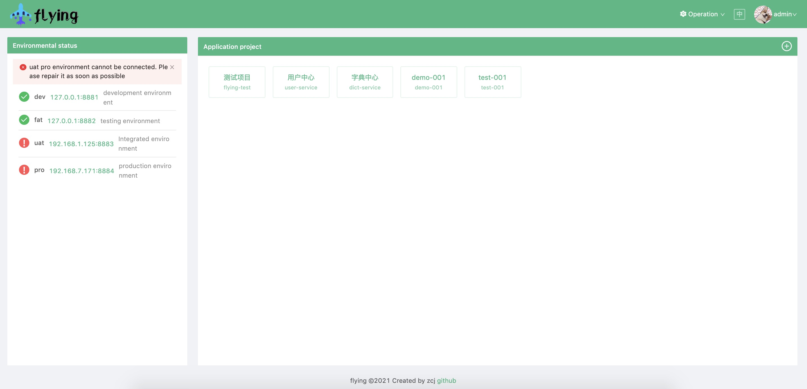

     

[Flying](https://github.com/ZhangChengJi/flying.git) 是微服务多环境云原生配置中心



> [English](README.md) | 中文

# Flying

------

## 项目介绍

Flying 是一个开源的云原生多环境配置中心，主要面向微服务、分布式系统和企业级多环境部署场景。

在现代企业系统中，服务通常不会只部署在一个固定环境里。一个真实的微服务平台往往需要同时管理开发环境、测试环境、预发布环境、生产环境、私有云、公有云以及多个 Kubernetes 集群中的配置。

Flying 的目标是提供一个统一、轻量、可私有化部署的配置管理基础设施，帮助团队集中管理应用配置，安全发布配置变更，并将配置实时推送到业务服务中。

Flying 适合以下场景：

- 云原生微服务平台
- 企业内部多环境系统
- Kubernetes 多集群部署系统
- 私有化部署的配置中心
- 内部开发者平台
- 分布式系统配置管理
- 需要轻量开源配置基础设施的团队

------

## 为什么需要 Flying

配置管理是微服务生态中的基础能力。

如果没有统一的配置中心，团队通常会遇到以下问题：

- 不同环境维护多份配置文件，容易混乱
- 配置修改后需要重新打包或重启服务
- 开发、测试、生产配置不一致
- 多集群部署时配置难以统一管理
- 配置变更缺少统一发布入口
- 服务数量增多后，人工维护成本快速上升

Flying 通过统一的配置中心解决这些问题。

它提供：

- 多环境配置统一管理
- 多集群配置服务管理
- 配置实时发布与热更新
- 基于 gRPC 的高效通信
- TLS 加密通信支持
- Web 管理控制台
- Spring Boot Java 客户端
- Docker / Kubernetes 部署支持
- 可扩展的模块化架构

Flying 虽然是一个轻量级项目，但它解决的是微服务和云原生生态中的通用基础设施问题：如何在多个环境、多个服务、多个集群之间，安全、稳定、高效地管理和下发配置。

------

## 核心特性

### 多环境配置管理

支持在一个管理控制台中维护多个环境的配置。

常见环境示例：

- `DEV`：开发环境
- `FAT`：功能测试环境
- `UAT`：用户验收 / 回归测试环境
- `PRO`：生产环境

### 多集群支持

Flying 适用于多个 Kubernetes 集群或多个隔离环境的配置管理场景。

管理员可以在 `flying-admin` 中统一管理部署在不同环境中的 `flying-config` 配置服务。

### 配置热更新

配置修改并发布后，客户端可以实时接收最新配置，无需重启业务应用。

### gRPC 通信

Flying 使用 gRPC 作为核心远程通信协议，适合分布式配置推送和服务间通信场景。

### TLS 安全通信

支持基于 TLS 的加密通信，适合企业内部系统和对安全有要求的私有化部署场景。

### Web 管理控制台

`flying-admin` 提供配置管理控制台，支持：

- 环境管理
- 应用管理
- 命名空间管理
- 配置编辑
- 配置发布
- 配置服务连接状态监控

### Spring Boot 客户端

`flying-client` 可集成到 Spring Boot 应用中，用于从 Flying 加载配置并监听配置变化。

### Docker / Kubernetes 部署

项目提供 Docker Compose 和 Kubernetes 部署文件，既可以用于本地快速启动，也可以部署到云原生环境中。

------

## 系统架构

Flying 主要由三个核心组件组成：

```text
┌──────────────────────┐
│     flying-admin     │
│      管理控制台       │
└──────────┬───────────┘
           │
           │ 管理环境、应用、命名空间与配置发布
           ▼
┌──────────────────────┐
│    flying-config     │
│      配置服务端       │
└──────────┬───────────┘
           │
           │ gRPC + TLS
           │ 实时配置推送
           ▼
┌──────────────────────┐
│    flying-client     │
│      应用客户端       │
└──────────────────────┘
```

### flying-admin

配置中心管理控制台，用于统一管理多个 `flying-config` 服务。

主要职责：

- 管理环境
- 管理应用
- 管理命名空间
- 编辑配置
- 发布配置
- 查看配置服务连接状态

### flying-config

配置服务端，负责存储和下发配置。

主要职责：

- 存储配置数据
- 响应客户端配置拉取请求
- 推送配置变更通知
- 支持部署到多个环境或多个集群

### flying-client

业务应用侧客户端。

主要职责：

- 应用启动时加载远程配置
- 监听配置变更
- 实时刷新应用配置
- 集成 Spring Boot 应用

当前项目已实现 Java 客户端，后续可继续扩展 Go、Node.js 等多语言客户端。

------

## 项目结构

```text
flying
├── deployments       # Docker Compose 和 Kubernetes 部署文件
├── docs              # 项目文档
├── flying-admin      # 管理控制台后端
├── flying-client     # Java 客户端 SDK
├── flying-config     # 配置服务端
├── flying-ui         # Web 管理界面
├── proto             # gRPC 协议定义
├── README.md
├── README_zh.md
└── LICENSE
```

------

## 快速开始

### 1. 克隆项目

```bash
git clone https://github.com/ZhangChengJi/flying.git
cd flying
```

### 2. 使用 Docker Compose 启动

```bash
docker-compose -f ./deployments/docker-compose/docker-compose.yml up
```

服务启动后，访问管理控制台：

```text
http://localhost:8888
```

默认账号：

```text
用户名：admin
密码：123456
```

> 注意：Docker Compose 更适合本地开发和测试环境。生产环境建议使用高可用数据库和更完整的部署策略。

------

## 配置环境连接

启动管理控制台后，需要在后台配置环境，并连接对应的 `flying-config` 配置服务。

如果使用 Docker Compose 部署，在 Docker 网络内部不要直接使用 `localhost:8881`，建议使用服务名或本机局域网 IP：

```text
flying-config:8881
```

或：

```text
{本机IP}:8881
```

推荐环境命名：

| 环境  | 说明                    |
| ----- | ----------------------- |
| `DEV` | 开发环境                |
| `FAT` | 功能测试 / Alpha 环境   |
| `UAT` | 用户验收 / 回归测试环境 |
| `PRO` | 生产环境                |

------

## Java 客户端使用

### 1. 添加 Maven 依赖

在 Spring Boot 项目中引入 `flying-client`：

```xml
<dependency>
    <groupId>com.github.zhangchengji</groupId>
    <artifactId>flying-client</artifactId>
    <version>1.0.0</version>
</dependency>
```

### 2. 配置 bootstrap.yml

将 `application.yml` 改为 `bootstrap.yml`，或者新增 `bootstrap.yml` 文件。

示例配置：

```yaml
spring:
  profiles:
    active: ${ACTIVE:dev}

  flying:
    bootstrap:
      app-id: flying-example
      enabled: true
      refresh-enabled: true
      namespace: default
      address:
        - name: dev
          url: flying-config.flying.svc:8881
        - name: uat
          url: flying-config-uat.flying.svc:8881
        - name: pro
          url: flying-config-pro.flying.svc:8881
```

字段说明：

| 字段              | 说明                                |
| ----------------- | ----------------------------------- |
| `app-id`          | 在 Flying 中注册的应用名称          |
| `enabled`         | 是否启用 Flying 配置中心            |
| `refresh-enabled` | 是否启用配置实时刷新                |
| `namespace`       | 服务端配置的命名空间                |
| `address.name`    | 环境名称                            |
| `address.url`     | 对应环境的 `flying-config` 服务地址 |

完整 Spring Boot 示例项目：

```text
https://github.com/ZhangChengJi/flying-example
```

------

## Kubernetes 多环境部署建议

在多个 Kubernetes 集群中使用 Flying 时，推荐采用以下部署模式：

- 将 `flying-admin` 部署在内部网络或管理集群中
- 在每个业务环境或 Kubernetes 集群中部署独立的 `flying-config`
- 每个业务服务优先连接本集群内的 `flying-config`
- 管理控制台统一管理多个环境的配置服务
- `flying-config` 对外暴露的 gRPC 地址建议使用内网、专线或受控访问入口
- 通信建议开启 TLS 加密

Kubernetes 内部服务地址示例：

```text
flying-config.flying.svc:8881
```

这种模式可以减少跨集群依赖，同时保留统一管理能力。

------

## 生产环境建议

生产环境使用 Flying 时，建议：

- 使用高可用数据库
- 为 `flying-config` 设置合理的资源限制
- 启用 gRPC TLS 证书
- 限制管理控制台只能在内网访问
- 配置数据备份与恢复机制
- 使用 Kubernetes 健康检查探针
- 区分开发、测试、预发布、生产环境
- 增加配置发布审计日志
- 增加基于团队和角色的权限管理
- 对重要配置发布增加审批或确认流程

------

## 典型使用场景

### 企业微服务平台

Flying 可以作为企业内部微服务平台的统一配置中心，帮助团队管理多个服务在不同环境下的配置。

### Kubernetes 多集群系统

对于部署在多个 Kubernetes 集群中的系统，Flying 可以通过多个 `flying-config` 服务实现分环境、分集群配置管理。

### 内部开发者平台

Flying 可以集成到企业内部开发者平台中，为研发团队提供自助式配置管理能力。

### 私有化部署配置中心

对于需要轻量、自托管、可二次开发配置中心的团队，Flying 可以作为一个开源基础框架。

------

## 技术栈

Flying 采用多语言和云原生技术栈：

- Go
- Java
- Vue
- JavaScript
- gRPC
- TLS
- Docker
- Kubernetes

------

## 生态价值

Flying 对开源生态的价值在于，它提供了一个面向云原生微服务系统的配置管理基础设施。

它不是单纯的业务系统，而是一个可以被其他系统复用和扩展的底层组件。对于微服务平台、企业内部系统、Kubernetes 多环境部署、私有化交付等场景，配置中心都是非常核心的基础能力。

Flying 通过开源方式提供了：

- 可学习的配置中心实现
- 可私有化部署的配置管理方案
- 可扩展的客户端 SDK 架构
- 面向企业微服务的多环境管理模型
- gRPC + TLS 的配置通信实践
- Docker / Kubernetes 部署参考

这使它不仅适合作为实际项目使用，也适合作为学习微服务配置中心、云原生基础设施和分布式系统设计的参考项目。

------

## 路线图

后续计划和推荐改进方向：

- 支持 Spring Boot 3
- 完善 Kubernetes 部署模板
- 增强权限管理和角色控制
- 增加配置版本历史
- 支持配置回滚
- 增加配置发布审计日志
- 支持灰度配置发布
- 增加 Go 客户端 SDK
- 增加 Node.js 客户端 SDK
- 补充 REST API 文档
- 支持 Helm Chart 部署
- 集成 Prometheus / Grafana 可观测能力
- 增加更多企业微服务示例

------

## 贡献指南

欢迎参与贡献。

你可以通过以下方式参与项目：

- 提交 Bug
- 改进文档
- 增加部署示例
- 增加更多语言客户端
- 改进 Spring Boot 兼容性
- 完善 Kubernetes 部署支持
- 提交 Pull Request

提交 PR 前，请确保代码清晰、可读、经过测试，并符合项目整体架构设计。

------

## 开源协议

Flying 使用 Apache License 2.0 开源协议。

详情请查看 `LICENSE` 文件。

------

## 联系方式

维护者：ZhangChengJi

邮箱：

```text
380702562@qq.com
```

GitHub：

```text
https://github.com/ZhangChengJi
```
